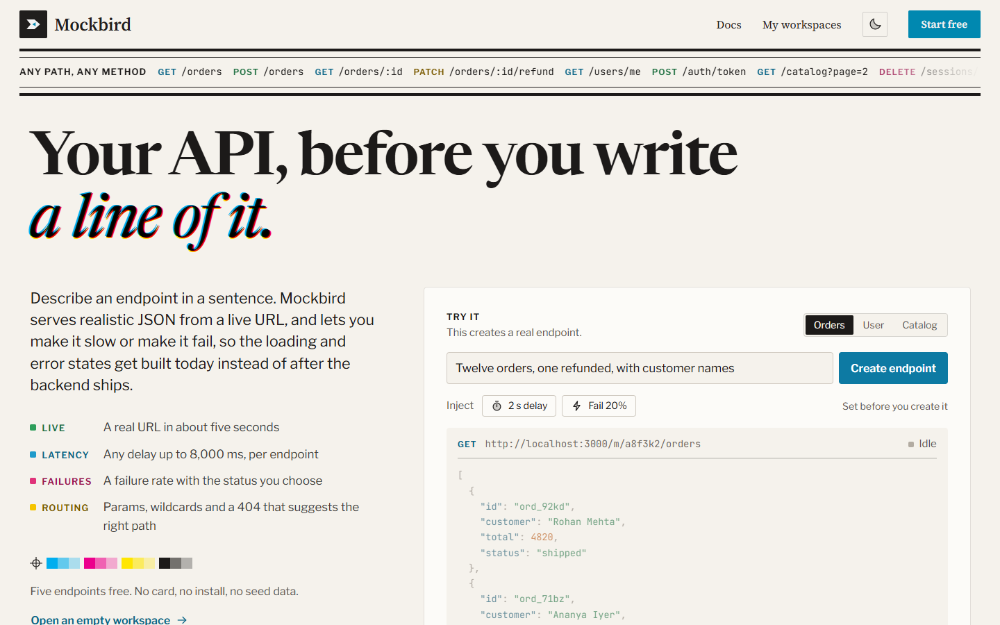
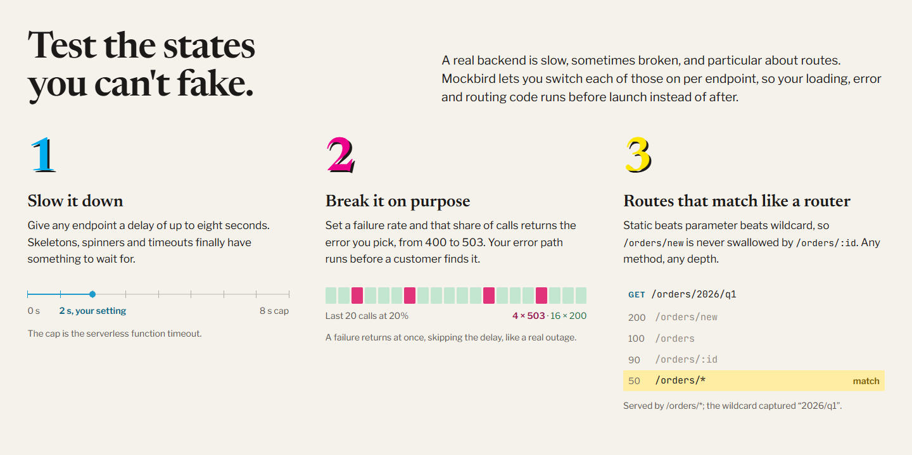
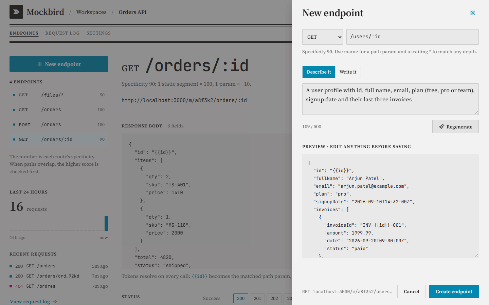
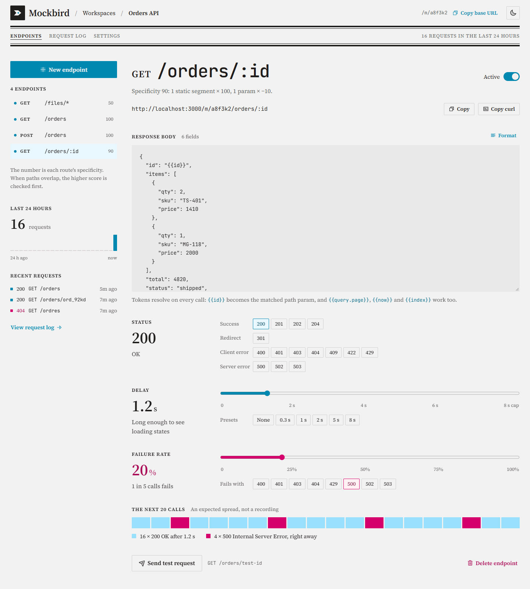
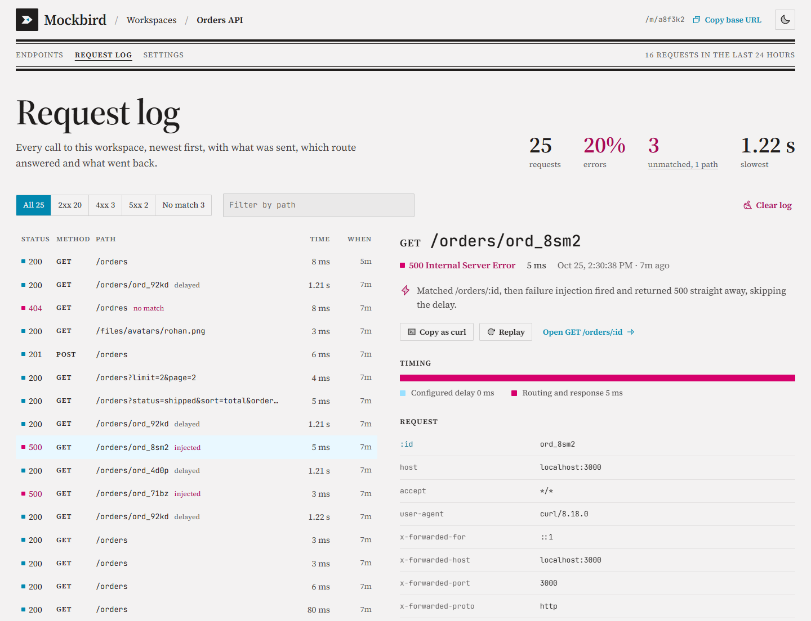
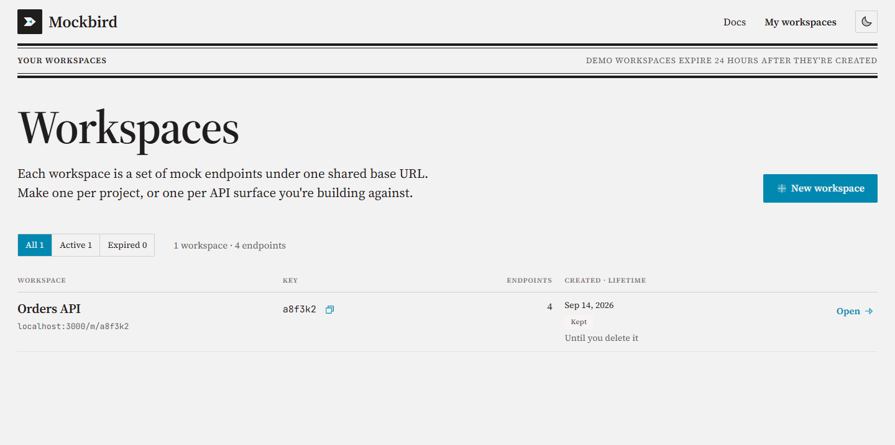
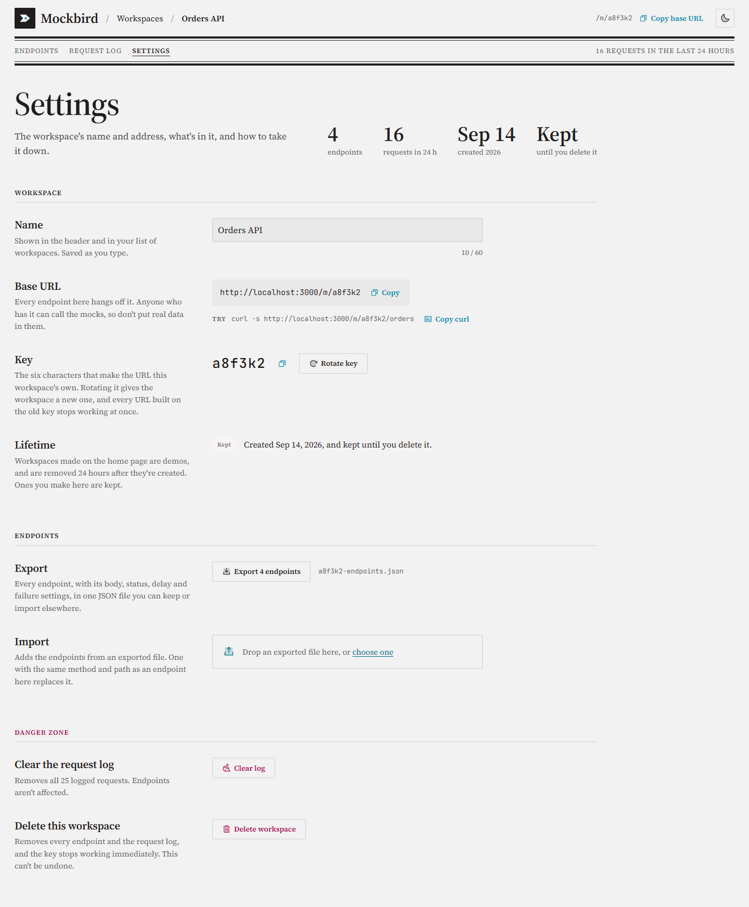
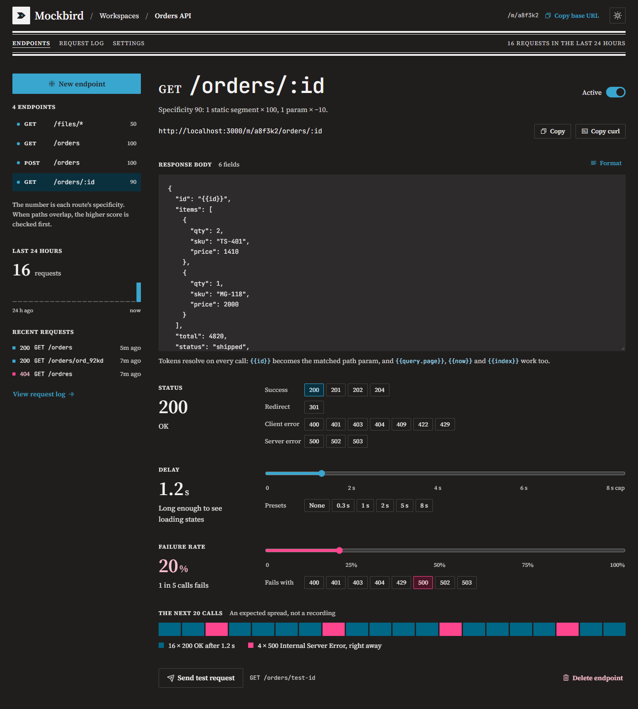

<p align="center">
  
</p>

<h1 align="center">Mockbird</h1>

<p align="center">
  <b>Describe an API in English, get a live mock endpoint in five seconds,<br>with latency and failure injection built in.</b>
</p>

<p align="center">
  
  
  
  
</p>

<p align="center">
  <a href="#quick-start">Quick start</a> ·
  <a href="#a-tour">Tour</a> ·
  <a href="#how-routing-works">How routing works</a> ·
  <a href="#request-lifecycle">Request lifecycle</a> ·
  <a href="#architecture">Architecture</a> ·
  <a href="#limitations-stated-plainly">Limitations</a>
</p>

<picture>
  <source media="(prefers-color-scheme: dark)" srcset="docs/screenshots/landing-dark.png">
  
</picture>

```
$ curl -s https://mockbird.app/m/a8f3k2/orders

[
  { "id": "ord_92kd", "customer": "Rohan Mehta", "total": 4820, "status": "shipped" },
  { "id": "ord_71bz", "customer": "Ananya Iyer", "total": 1290, "status": "pending" }
]
```

## Why

A frontend developer needs an endpoint the backend team hasn't written yet, so the screen waits. Mockbird gives them a live URL returning realistic JSON immediately, so the screen gets built today. It also does two things a real backend won't do on request: respond slowly, and fail one call in five. That's how loading and error states actually get tested.



## Quick start

You need **Node 18.17+** and **Docker** (or any Postgres you can point `DATABASE_URL` at).

```bash
docker compose up -d              # Postgres on :5432
cp .env.example .env              # DATABASE_URL already points at the compose Postgres
npm install                       # also runs prisma generate
npm run db:push                   # create the tables
npm run seed                      # workspace a8f3k2 with four example endpoints
npm run dev                       # http://localhost:3000
```

Then, in another terminal:

```bash
curl -s http://localhost:3000/m/a8f3k2/orders
curl -s http://localhost:3000/m/a8f3k2/orders/ord_92kd     # 1.2s delay, fails 20% of the time
curl -s http://localhost:3000/m/a8f3k2/ordres              # 404 that tells you what does exist
```

`GROQ_API_KEY` is optional (get a free one at [console.groq.com](https://console.groq.com)). Without it the **Describe it** tab falls back to a hand-written skeleton and everything else works exactly the same. The product is fully usable with the AI switched off.

### Environment

| Variable | Default | What it does |
|---|---|---|
| `DATABASE_URL` | compose Postgres | Postgres connection string. On Neon, use the pooled URL with `?pgbouncer=true` |
| `NEXT_PUBLIC_APP_URL` | `http://localhost:3000` | Public origin, used to build the mock URLs shown in the UI |
| `GROQ_API_KEY` | unset | Turns on **Describe it**. Unset means the manual editor only |
| `AI_MODEL` | `openai/gpt-oss-20b` | Any chat-completion model Groq serves |
| `UPSTASH_REDIS_REST_URL`, `UPSTASH_REDIS_REST_TOKEN` | unset | Shared cache and rate limiting across instances. Unset falls back to an in-process map |
| `MOCK_RATE_LIMIT` | `60` | Requests per minute allowed per workspace key on the mock route |

### Scripts

| Command | |
|---|---|
| `npm run dev` | Dev server with hot reload |
| `npm run build` / `npm start` | Production build and server |
| `npm test` | 39 unit tests: path compiling, matching, substitution, path guessing |
| `npm run typecheck` | `tsc --noEmit` |
| `npm run db:push` / `npm run db:studio` | Push the Prisma schema, or browse the data |
| `npm run seed` | The `a8f3k2` workspace used in the examples and screenshots |

---

## A tour

Every screenshot below is the seeded `a8f3k2` workspace, after a handful of the `curl` calls above.

### Describe it, or write it



Pick a method and path, then describe the response in a sentence. The model drafts a JSON Schema and sample records once, at creation, and wires path params like `:id` to `{{id}}` so they resolve per request. The preview is editable, and nothing is saved until you press **Create endpoint**. Prefer to skip the model? **Write it** takes plain JSON.

### Make it slow, make it fail



Each endpoint has its own status code, delay (up to 8 s) and failure rate, with the status a failed call returns. The strip under the sliders shows the spread you should expect over the next 20 calls, and **Send test request** fires one from the page. The sidebar lists every route with its specificity, the score that decides which route wins when paths overlap.

### See every call



The log records what was sent, which route answered and why, and what went back. Injected failures, delayed calls and unmatched paths are labelled inline. The detail pane splits the configured delay from routing time, and any call can be copied as `curl` or replayed.

### And the rest

<table>
  <tr>
    <td width="50%"></td>
    <td width="50%"></td>
  </tr>
  <tr>
    <td align="center"><sub><b>Workspaces.</b> One base URL per project or API surface.</sub></td>
    <td align="center"><sub><b>Settings.</b> Rotate the key, export or import endpoints as JSON.</sub></td>
  </tr>
  <tr>
    <td width="50%"></td>
    <td width="50%"></td>
  </tr>
  <tr>
    <td align="center"><sub><b>Day edition.</b></sub></td>
    <td align="center"><sub><b>Night edition.</b> Follows the OS, or the toggle in the header.</sub></td>
  </tr>
</table>

---

## How routing works

This is the part worth reading.

A stored path is never matched as a string. When an endpoint is saved, its path is split into segments and given a numeric specificity, and both are persisted:

```
"/orders/:id/items"  ->  [
  { type: "static", value: "orders" },
  { type: "param",  name:  "id"     },
  { type: "static", value: "items"  }
]
```

```
specificity = (staticSegments * 100) - (paramSegments * 10) - (hasWildcard ? 50 : 0)
```

At request time the handler asks Postgres for the active endpoints matching `(workspaceId, method)`, ordered by `specificity DESC`. That query is served by a compound index, so **the ordering happens in the database, not in Node**, and the matcher itself does no sorting at all. It walks the list and takes the first pattern that fits.

Precedence falls out of the numbers:

| Pattern | Specificity | `/orders/new` | `/orders/ord_92kd` | `/orders/a/b` |
|---|---:|---|---|---|
| `/orders/new` | 200 | ✅ wins | — | — |
| `/orders/:id` | 90 | (loses) | ✅ wins | — |
| `/orders/*` | 50 | (loses) | (loses) | ✅ wins |

Matching rules, in [`src/lib/match.ts`](src/lib/match.ts):

- segment count must be equal, unless the pattern ends in a wildcard
- static segments compare case-sensitively
- param segments match any non-empty segment and capture it
- a trailing `*` matches any depth below it and captures the remainder

**When nothing matches**, the 404 body lists every path the workspace actually serves and runs a Damerau-Levenshtein comparison against the requested path, so a typo answers with a suggestion instead of a dead end:

```json
$ curl -s http://localhost:3000/m/a8f3k2/ordres

{
  "error": "No endpoint matched",
  "requested": "GET /ordres",
  "available": ["GET /files/*", "GET /orders", "POST /orders", "GET /orders/:id"],
  "didYouMean": "/orders",
  "hint": "You called /ordres. Did you mean /orders?"
}
```

The matcher and the path compiler have 22 unit tests between them, out of 39 in all: `npm test`.

### Token substitution

The stored body may contain tokens that resolve against the request:

| Token | Resolves to |
|---|---|
| `{{id}}` | the matched path param of that name |
| `{{query.page}}` | a query-string value, `""` when absent |
| `{{wildcard}}` | everything captured by a trailing `*` |
| `{{now}}` | ISO timestamp at request time |
| `{{index}}` | position inside the enclosing array, as a number |
| `{{random.name}}`, `{{random.int}}` | fake data, different every request |

So `GET /orders/:id` returns a body whose `id` field matches what was asked for. A string that is nothing but one token takes that token's native type, so `"qty": "{{index}}"` comes back as `0`, not `"0"`.

### Collection filtering

When the body is an array, `?limit=`, `?offset=`, `?page=`, `?sort=`, `?order=` and any `?field=value` are applied server-side. One mock becomes a usable paginated list endpoint:

```bash
curl -s "http://localhost:3000/m/a8f3k2/orders?status=shipped&sort=total&order=desc"
curl -s "http://localhost:3000/m/a8f3k2/orders?limit=2&page=2"
```

---

## Request lifecycle

```
GET /m/a8f3k2/orders/ord_92kd
  │
  ├─ middleware.ts        rate limit on the workspace key straight from the URL,
  │                       before the function does any work
  ├─ resolve workspace    Redis, 60s TTL; falls back to an in-process map
  ├─ load candidates      indexed on (workspaceId, method, specificity DESC)
  ├─ match route          first fit wins; capture params and wildcard
  ├─ roll failureRate     if it fires, return the failure body immediately
  ├─ sleep(delayMs)       capped at 8000ms
  ├─ substitute tokens    then apply collection query params
  ├─ write RequestLog     and increment hitCount
  └─ return responseBody  with the stored status and headers
```

No background worker, no websocket, no cron. Every operation completes inside one request. The log trims itself to the most recent 500 rows per workspace inside the write that overflows it, on roughly one call in twenty so the cost is amortised.

## Where the AI sits

Two things, once, at creation time: it turns the English description into a JSON Schema, and it generates sample records matching that schema. The result is shown in an editable field and nothing is written until you press **Create endpoint**. If the key is missing or the model's reply can't be used, the drawer says so and drops in a hand-written skeleton instead, so creating an endpoint never dead-ends.

**At request time there is no model call at all.** The response is read from Postgres and returned verbatim, so the same request returns the same bytes every time. That determinism is the whole point. A mock that returns different data on every call is useless to build a UI against, and per-request inference would add seconds of latency and real cost.

## Architecture

| Layer | Choice |
|---|---|
| App | Next.js App Router. One catch-all route handles every mock method and path |
| DB | Postgres via Prisma (Neon's pooled URL with `?pgbouncer=true` in production) |
| Cache + rate limits | Upstash Redis over HTTP, so it works in serverless; in-process fallback when unset |
| Identity | A cookie-backed user in [`src/lib/auth.ts`](src/lib/auth.ts). Everything above it only calls `currentUser()`, so dropping in Auth.js with a GitHub provider means replacing one function body |
| AI | Any chat completion endpoint, one call at creation |

```
src/lib/path.ts        compile a path into segments + specificity
src/lib/match.ts       the matcher and the "did you mean" hint
src/lib/template.ts    token substitution
src/lib/collection.ts  limit / offset / sort / field filtering
src/lib/endpoints.ts   validation and clamping before anything reaches the DB
src/lib/ai.ts          the one model call, and the skeleton it falls back to
src/app/m/[key]/[[...path]]/route.ts   the one handler that serves every mock
```

## Limitations, stated plainly

- **The landing-page demo is a real, temporary workspace.** Typing a description into the **Try it** card on `/` creates an actual workspace via `POST /api/demo`, the same code path as the full editor. It's capped at 10 per hour per visitor and expires in 24 hours, so the curl command a visitor copies keeps working for a day and then quietly 404s.
- **Mocks are public.** The workspace key is unguessable but not secret. Don't put real data in them.
- **POST doesn't persist.** It returns its configured body; it doesn't append to the collection `GET` returns. Stateful mocks would need per-workspace collection storage and a reset button. That's a deliberate omission, not an oversight.
- **Delay is capped at 8 seconds** by the serverless function timeout.
- **Request logging is a write on every call.** That's the first thing that breaks at scale; it would need batching or a queue.
- Response bodies are capped at 256KB and the log keeps 500 rows per workspace.

## Deploying

- Vercel + Neon. Use the pooled connection string with `?pgbouncer=true`.
- Set `NEXT_PUBLIC_APP_URL` so the UI shows the right mock URLs.
- Add the Upstash variables to get shared caching and rate limiting across instances.
- `MOCK_RATE_LIMIT` controls requests per minute per workspace key (default 60).

## Troubleshooting

- **`Cannot find module './vendor-chunks/…'` in dev.** The `.next` cache is stale, usually after a dev server or build was interrupted. Delete `.next` and run `npm run dev` again.
- **Prisma can't reach the database server.** Postgres isn't up. Start Docker, then `docker compose up -d`.
- **Describe it always returns the skeleton.** Check `GROQ_API_KEY`. The note under the preview gives the reason, including the free tier's rate limit.

---

<p align="center">
  Built by Chinmay Dubey · <a href="https://github.com/ChinmayDubey231">github.com/ChinmayDubey231</a>
</p>
